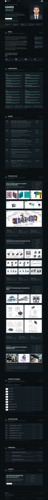

# Portfolio — HAMDI Ahmed (édition sans PDF)

Portfolio d'ingénierie mécanique et d'industrialisation, en une seule page :
conception de moules, outillages, convoyeurs, simulation, qualité.

**Édition sans document PDF** : aucun rapport, CV ni plan n'est mis en ligne.
Toutes les planches restent consultables en **images JPG plein écran**, et les
deux animations en **vidéo MP4**. Design, modes jour/nuit et FR/EN identiques
à l'édition complète.



## Voir le site

```
https://VOTRE-COMPTE.github.io/portfolio-v5/
```

En local, ouvrir `index.html` dans Chrome : tout fonctionne sans réseau.

## Contenu

| Section | Contenu |
|---|---|
| Hero | nom, méthode, disponibilité (stage de fin d'études, 6 mois, février 2027) |
| 01 Profil | parcours, citation, chiffres clés |
| 02 Compétences | 20 compétences et 4 familles d'outils |
| 03 Stages | 5 stages 2021 → 2025 |
| 04 Études de cas | moule d'injection, convoyeur bi-étage, dispositif de soudure, bridage aéronautique |
| 05 Dossier technique | registre des 9 planches, consultables en JPG grand format |
| 06 Certifications | 6 certifications SOLIDWORKS avec identifiants vérifiables en ligne |
| 07 Formation | Arts et Métiers Paris, ENIB Bizerte, ISET Bizerte |
| 08 Contact | e-mail, téléphone, LinkedIn |

## Fonctionnalités

- **Mode jour / nuit** instantané et mémorisé.
- **Français / English**, 100 % bilingue.
- Visionneuse plein écran pour les images et les planches.
- Vidéos MP4 : lecture au clic, une seule à la fois.
- Sommaire actif, jauge de lecture, menu mobile.
- Responsive vérifié de 320 px à 1920 px.

## Structure

```
.
├── index.html
├── apercu-page-complete.jpg · apercu-mode-matin.jpg
├── .nojekyll · .gitignore · LICENSE
└── assets/
    ├── css/style.css · js/main.js
    ├── fonts/   6 woff2
    ├── img/     28 visuels
    └── media/   2 MP4 + 2 affiches
```

## Publier sur GitHub Pages

1. Dépôt public `portfolio-v5`, sans README initial.
2. Glisser **le contenu** de ce dossier (pas le dossier lui-même).
3. **Settings → Pages** → *Deploy from a branch* → **main** / **/(root)** → **Save**.
4. Après 1 à 2 minutes : `https://VOTRE-COMPTE.github.io/portfolio-v5/`

Le fichier `.nojekyll` (caché par Windows/macOS) est indispensable.

## Contact

HAMDI Ahmed — Paris 14ᵉ — <ahmed.hamdi@ensam.eu>
[LinkedIn](https://www.linkedin.com/in/ahmed-hamdi-46b119211/)

---

Code sous licence MIT · Contenus (photos, rendus) tous droits réservés.
